

# Mr. Digeshwar

**Java Full Stack Developer**

BUILD • OBSERVE • SECURE • AUTOMATE • DEPLOY • SCALE

`Java` `Spring Boot` `Docker` `Git` `GitHub Actions` `JavaScript` `CSS`

## GitHub stats

<picture><source media="(prefers-color-scheme: dark)" srcset="./cards/stats.svg"></picture>
<picture><source media="(prefers-color-scheme: dark)" srcset="./cards/streak.svg"></picture>
<picture><source media="(prefers-color-scheme: dark)" srcset="./cards/activity.svg"></picture>
<picture><source media="(prefers-color-scheme: dark)" srcset="./cards/universe.svg"></picture>

## Stack

<picture><source media="(prefers-color-scheme: dark)" srcset="./cards/languages.svg"></picture>

## Timeline

<picture><source media="(prefers-color-scheme: dark)" srcset="./cards/timeline.svg"></picture>

## Projects

<a href="https://github.com/G1thub-05/G1thub-05"><picture><source media="(prefers-color-scheme: dark)" srcset="./cards/project-1.svg"></picture></a>
<a href="https://github.com/G1thub-05/PortFolio"><picture><source media="(prefers-color-scheme: dark)" srcset="./cards/project-2.svg"></picture></a>
<a href="https://github.com/G1thub-05/Online-Food-Ordering-System"><picture><source media="(prefers-color-scheme: dark)" srcset="./cards/project-3.svg"></picture></a>
<a href="https://github.com/G1thub-05/E-Commerce-App"><picture><source media="(prefers-color-scheme: dark)" srcset="./cards/project-4.svg"></picture></a>

## Recently pushed

<picture><source media="(prefers-color-scheme: dark)" srcset="./cards/recent.svg"></picture>

---
Patched together from public GitHub data · made with <a href="https://readme-glassfolio.in/">Patch your profile</a>
